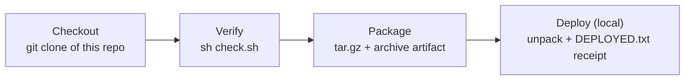

# Jenkins CI/CD Pipeline — Static Web App

A complete, working **CI/CD pipeline in Jenkins**: every run pulls this repository, verifies the app, packages it as a versioned artifact, archives that artifact in Jenkins, and deploys it to a local target folder with a written deployment receipt.

Jenkins itself runs in Docker (`jenkins/jenkins:lts`), and the pipeline is defined **as code** in the `Jenkinsfile` in this repo — the same way production teams run it.



## What each stage does

| Stage | What happens | Why it matters |
|---|---|---|
| **Checkout** | Jenkins clones this repo automatically (Pipeline from SCM) | The build always runs on committed code, never on hand-copied files |
| **Verify** | `check.sh` fails the build unless `index.html`, `style.css`, `app.js` all exist and the page carries the company title | A broken delivery stops early instead of shipping |
| **Package** | Files are packed into `zaintech-web-<build number>.tar.gz` and **archived as a build artifact** with a fingerprint | Every build produces one versioned, downloadable artifact |
| **Deploy (local)** | The artifact is copied to a releases folder, unpacked into `current/`, and a `DEPLOYED.txt` receipt (app, build number, timestamp) is written | Deployment is provable after the fact, not just claimed |

## The app

A deliberately small static page for **Zain Tech Automation Solutions** (`index.html`, `style.css`, `app.js`). Its job is to be built, checked, packaged and deployed — the pipeline is the project.

## Running it

1. Start Jenkins in Docker:
   ```bash
   docker run -d --name jenkins -p 8080:8080 -v jenkins_home:/var/jenkins_home jenkins/jenkins:lts
   ```
2. Unlock Jenkins, install the suggested plugins, create the admin user.
3. **New Item → Pipeline**, name it e.g. `zaintech-web-pipeline`.
4. Pipeline definition: **Pipeline script from SCM** → Git → this repo's URL → branch `main` → script path `Jenkinsfile`.
5. **Build Now** — watch the stages go green in the Stage View and read the full log in Console Output.

## Files

| File | Contents |
|---|---|
| `Jenkinsfile` | The declarative pipeline: Verify → Package → Deploy, with success/failure messages |
| `check.sh` | The Verify stage's checks (required files + page title) |
| `index.html` · `style.css` · `app.js` | The static demo app being delivered |
| `docs/` | Screenshots of the real run (added after the first successful pipeline build) |

## Skills demonstrated

Jenkins administration (Docker install, unlock, plugins, users) · freestyle jobs and build logs · declarative pipelines (`Jenkinsfile`) · Pipeline-from-SCM · build artifacts and versioning · shell scripting · deployment receipts and verification

---

## Author

**Zain Ul Abdin** — Founder, **Zain Tech Automation Solutions** · Karachi, Pakistan
GitHub: [@zain-ul-abadeen-1213](https://github.com/zain-ul-abadeen-1213)
